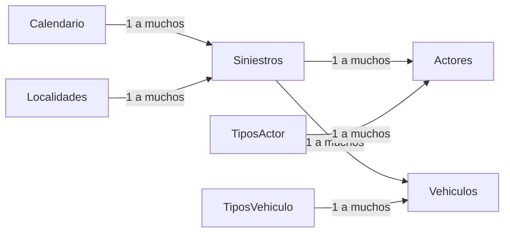

# Modelo dimensional

Todas las relaciones están activas y filtran en el sentido de las flechas. El modelo conserva tres granularidades. Calendario y localidad filtran el evento y este propaga el filtro a ambos detalles. Severidad y hora del evento también se propagan. Los tipos de actor y de vehículo filtran su propio detalle.

- **Siniestros** tiene una fila por año de `fecha` y `codigo_siniestro`. La clave de unión es `source_year|codigo_siniestro` de la edición elegida. El año de los análisis procede del calendario.
- **Actores** contiene registros de involucrados en esa edición, deduplicados por igualdad de todos los campos de origen. La fuente carece de un identificador universal de persona. El indicador cuenta participaciones registradas.
- **Vehiculos** contiene registros de vehículo. En origen, `source_year`, `codigo_siniestro` y `codigo_vehiculo` identifican la fila en los datos observados, con seis códigos de vehículo nulos.
- **Cruce actor–vehículo** intersecta las claves de evento mediante DAX. Mide coexistencia en el siniestro. La atribución de un actor a un vehículo específico queda fuera del modelo. La comprobación original encontró 25.494 referencias de actor a vehículo sin coincidencia cuando el código de vehículo estaba presente.
- **Diccionario** queda como consulta de referencia y se exportó completo en JSON. Describe códigos de la edición 2021. El esquema Parquet tiene encabezados que parecen una fila de datos, incluida la entrada de gravedad 1. Se preservaron los 102 registros sin inferir entradas ausentes.

Los recuentos por tipo de actor o vehículo son distintos por evento. Sus categorías se solapan, así que el total se calcula de nuevo en su propio contexto.
